# HKV – Open-Source-Heizkostenverteiler

Ein offener elektronischer Heizkostenverteiler nach dem Zweifühler-Prinzip (ähnlich EN 834). Er wird am Heizkörper montiert, zählt Verbrauchseinheiten, speichert Stichtags- und Monatswerte und versendet die Messwerte als OMS-/wireless-M-Bus-Telegramm.

**Status:** Prototyp auf einem Unexpected Maker TinyPICO (ESP32). Der Raumfühler (BMP280) und das Display (ST7735S) laufen bereits mit echter Hardware. Der Heizkörperfühler ist ein MLX90614 (GY-906-Modul). Die Simulation ist weiterhin als Rückfall-Option vorhanden. Das Zielsystem ist ein TI CC1312 (Sub-1-GHz, sehr stromsparend).

> **Rechtlicher Hinweis:** Für eine Abrechnung nach der Heizkostenverordnung braucht man zugelassene, normkonforme Geräte. Dieses Projekt ist für Eigenverbrauch, Vergleichsmessungen und Experimente gedacht und ersetzt das Gerät des Messdienstes nicht.

## Hintergrund

Die Heizkosten sind derzeit enorm hoch, gerade in schlecht isolierten Wohnungen, und über den laufenden Verbrauch hat man als Mieter keinerlei Kontrolle. Am Heizkörper hängt zwar ein elektronischer Heizkostenverteiler des Messdienstes, ein **ista doprimo 3 radio net**. Seine Funktelegramme sind aber AES-verschlüsselt, und den Schlüssel gibt der Hersteller nicht heraus. Man sieht seinen Verbrauch also erst mit der Jahresabrechnung, wenn es zu spät ist, noch etwas zu ändern.

Daher dieses Projekt: ein eigener, offener Heizkostenverteiler, dessen Werte man jederzeit selbst sieht, auf dem Display, in der Weboberfläche oder in Home Assistant.

**Erstes Ziel:** Messwerte, die denen des eingebauten doprimo 3 möglichst nahekommen. Dazu hängen beide Geräte am selben Heizkörper, und die Zuwächse werden verglichen. Das Verhältnis ergibt den Korrekturfaktor Kc (siehe [Messprinzip und Algorithmus](#messprinzip-und-algorithmus)).

**Warum zuerst ein ESP32?** Für den ESP32 gibt es sehr viele Ressourcen: Bibliotheken, Beispiele, Foren und günstige Entwicklungsboards. Damit lässt sich schnell und bequem entwickeln, mit WLAN, Weboberfläche und Display. Für ein batteriebetriebenes Gerät, das jahrelang am Heizkörper hängt, ist er aber viel zu stromhungrig.

**Später:** Portierung auf den **TI CC1312** (CC1312R, Sub-1-GHz-Funk-Mikrocontroller mit sehr geringem Stromverbrauch), mit deutlich weniger „Schnickschnack“: kein WLAN, keine Weboberfläche, kein Farbdisplay, Übertragung per wireless M-Bus. Deshalb ist der Code von Anfang an zweigeteilt. Der Kern (Messung, Bewertung, Zählerstände, Telegramme) ist plattformunabhängig und wird unverändert übernommen. Neu geschrieben werden nur die Treiber (siehe [Software-Architektur](#software-architektur-und-portierung-auf-den-cc1312)).

## So sieht's aus

**Weboberfläche:** Verbrauch, Temperaturen, Akku und Monatswerte auf einen Blick, im Heimnetz, am Handy oder in Home Assistant.

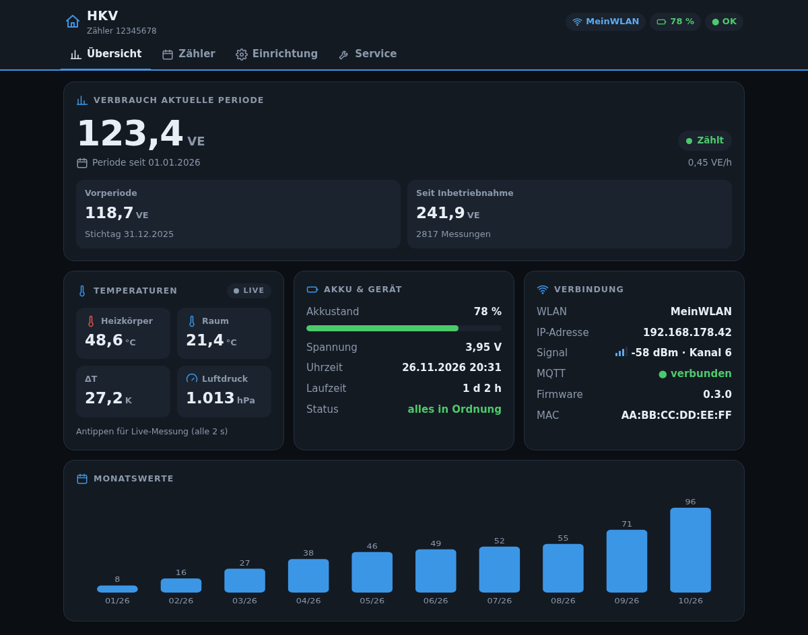

**Display am Gerät** (0,96″, 160 × 80 Pixel), per Taster durchblättern:

<table>
  <tr>
    <td align="center">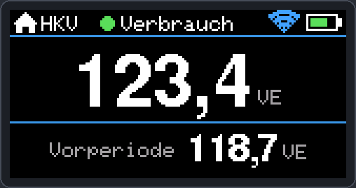<br><sub>Verbrauch aktuell und Vorperiode</sub></td>
    <td align="center">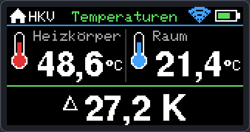<br><sub>Heizkörper, Raum und ΔT, live</sub></td>
  </tr>
  <tr>
    <td align="center">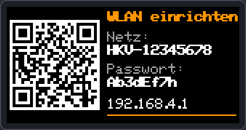<br><sub>WLAN-Einrichtung per QR-Code</sub></td>
    <td align="center">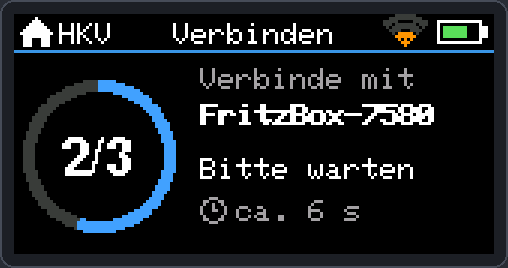<br><sub>Verbindungsaufbau</sub></td>
  </tr>
</table>

**Einrichtung in einer Minute:** QR-Code auf dem Display scannen, WLAN aus der Liste wählen, fertig. Die Zähler lassen sich im eigenen Tab verwalten.

<table>
  <tr>
    <td align="center" valign="top">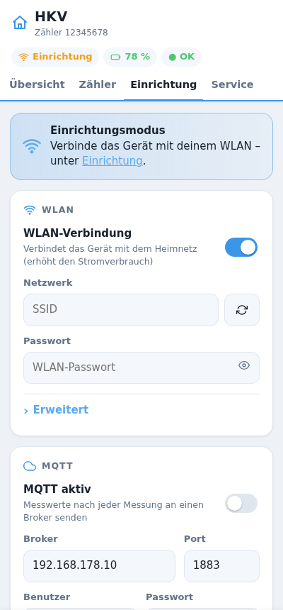<br><sub>Einrichtungsmodus am Handy</sub></td>
    <td align="center" valign="top">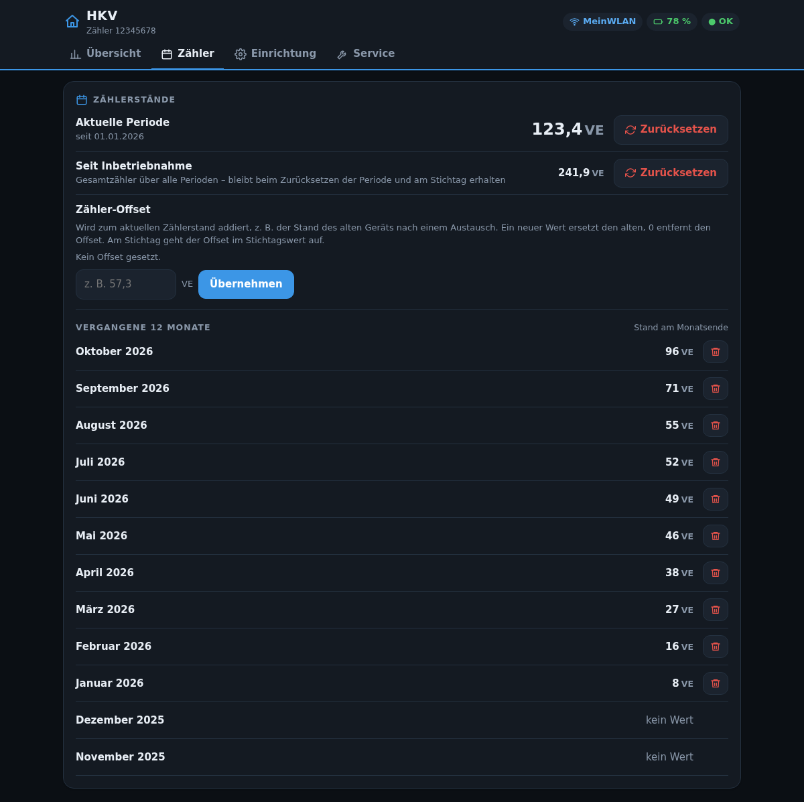<br><sub>Zählerstände, Offset nach Gerätetausch, Monatswerte</sub></td>
  </tr>
</table>

<details>
<summary><b>Weitere Ansichten</b> (helles Design, Service-Tab, alle Display-Seiten)</summary>

<br>

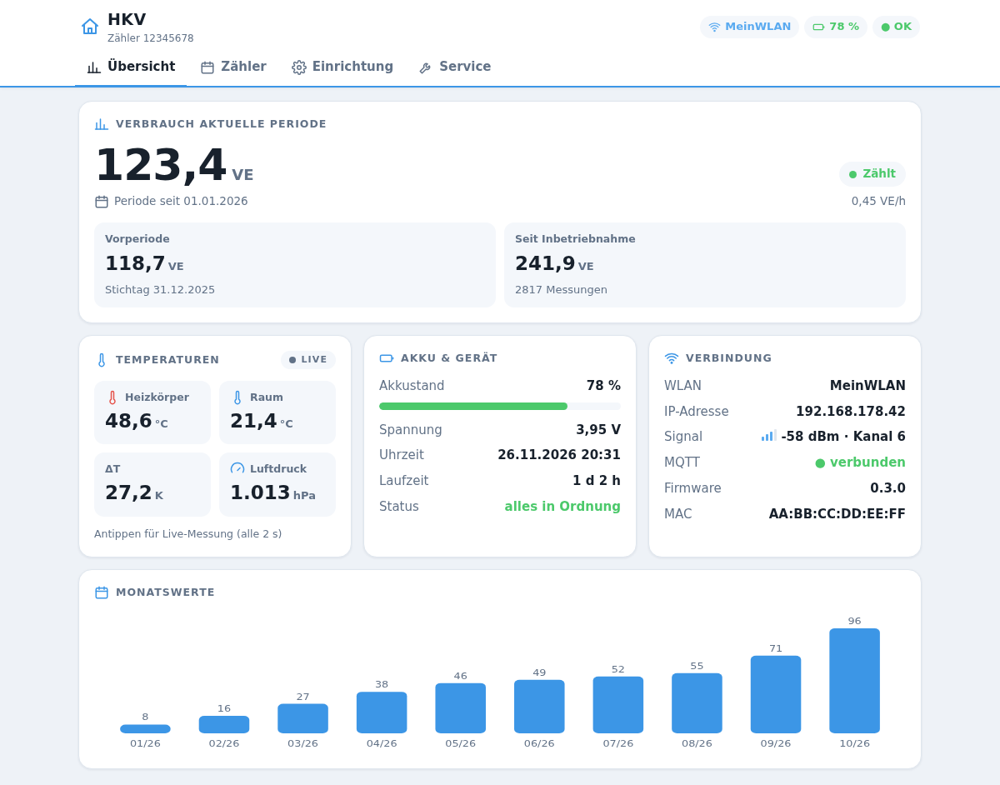

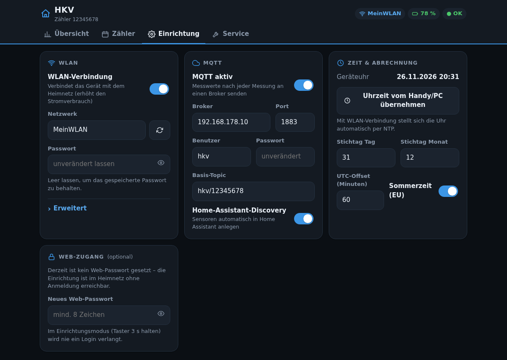

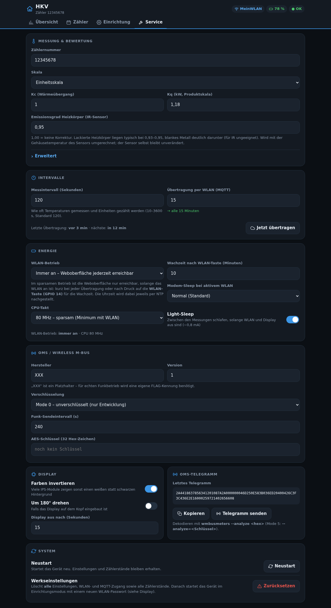

<table>
  <tr>
    <td align="center">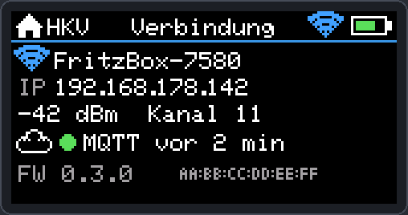<br><sub>Verbindung, MQTT, Firmware</sub></td>
    <td align="center">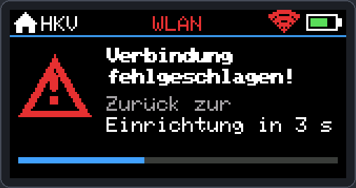<br><sub>Verbindung fehlgeschlagen</sub></td>
  </tr>
  <tr>
    <td align="center">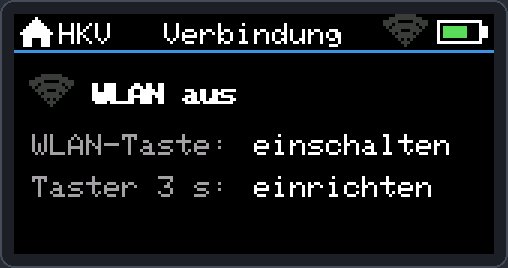<br><sub>WLAN aus (Energiesparen)</sub></td>
    <td align="center">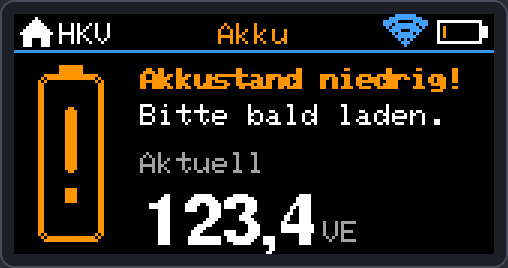<br><sub>Akku-Warnung</sub></td>
  </tr>
</table>

</details>

<sub>Alle Bilder zeigen Beispieldaten. Die Display-Bilder sind mit demselben Code gerendert wie auf dem Gerät (`tools/ui_preview`), die Weboberfläche läuft für die Screenshots gegen einen Beispieldaten-Server (`tools/web_preview`).</sub>

---

## Inhaltsverzeichnis

1. [Hardware und Pinbelegung](#hardware-und-pinbelegung)
2. [Bauen, Flashen, Testen](#bauen-flashen-testen)
3. [Bedienung](#bedienung)
4. [Messprinzip und Algorithmus](#messprinzip-und-algorithmus)
5. [OMS / wM-Bus-Telegramm](#oms--wm-bus-telegramm)
6. [Software-Architektur und Portierung auf den CC1312](#software-architektur-und-portierung-auf-den-cc1312)
7. [Offene Punkte](#offene-punkte)
8. [Lizenz](#lizenz)

---

## Hardware und Pinbelegung

| Komponente | Funktion |
|---|---|
| Unexpected Maker TinyPICO (V1/V2/V3, ESP32-PICO) | Prototyp-Controller, LiPo-Lader, Batteriemessung |
| Bosch BMP280 (I2C) | Raumluft-Temperatur und Luftdruck (ein BME280 würde zusätzlich die Luftfeuchte liefern) |
| MLX90614 (GY-906, I2C, 3-V-Variante) | Heizkörper-Oberflächentemperatur |
| ST7735S 0,96" 80×160 (SPI) | Anzeige, nur im Prototyp |
| Taster gegen GND | Anzeige / Seiten / Einrichtung |

Alle Angaben sind **GPIO-Nummern**. Die Pinbelegung steht zentral in [include/board_tinypico.h](include/board_tinypico.h).

| Signal | GPIO | Position am TinyPICO (Draufsicht, USB oben) |
|---|---|---|
| I2C SDA (BMP280, MLX90614) | 21 | links, 6. Pin |
| I2C SCL (BMP280, MLX90614) | 22 | links, 5. Pin |
| TFT SCK | 18 | links, 3. Pin |
| TFT MOSI (SDA am Display) | 23 | links, 1. Pin |
| TFT CS | 5 | links, 4. Pin |
| TFT DC | 25 | rechts, 10. Pin |
| TFT RES | 26 | rechts, 9. Pin |
| TFT BLK (optional über Transistor) | 27 | rechts, 8. Pin |
| Taster (gegen GND) | 4 | rechts, 5. Pin |
| 3V3 / GND | – | rechts 4. / rechts 2. Pin |
| Batteriespannung (intern) | 35 | nicht herausgeführt, Teiler 442k/160k |
| Ladezustand (intern) | 34 | nicht herausgeführt, LOW = lädt |
| DotStar-LED (intern) | 2 / 12 / 13 | wird beim Start abgeschaltet |

Hinweise:

- **GPIO 6 bis 11 dürfen nicht verwendet werden.** Sie sind intern mit dem Flash verbunden.
- Der BMP280 misst die Temperatur auf seinem eigenen Chip. Er sollte deshalb nicht neben dem ESP32, dem Display oder der Heizkörperplatte sitzen. Eine Abweichung lässt sich mit dem Raumfühler-Offset in der Weboberfläche ausgleichen.
- Die Hintergrundbeleuchtung (BLK) hängt an GPIO 27: HIGH = an, LOW = aus. Sie wird mit dem Display ein- und ausgeschaltet. Der Pin bleibt im Light Sleep auf LOW gehalten. Das funktioniert bei Modulen, deren BLK-Eingang selbst einen Transistor ansteuert. Hängt die LED direkt am Pin, braucht es einen eigenen Transistor. Ohne Schaltung `kTftBacklightSwitched = false` setzen und BLK an 3,3 V legen.
- Das Display wird im Hochformat (80×160) betrieben. Viele dieser IPS-Module haben ein invertiertes Panel. Deshalb ist `kTftInvertColors = true` gesetzt. Ist der Hintergrund trotzdem hell statt schwarz, den Wert auf `false` stellen. Ist das Bild verschoben, `kTftInitVariant` auf `0x06` (`INITR_MINI160x80_PLUGIN`) umstellen. Steht es auf dem Kopf, `kTftRotation` auf 2 setzen.
- MLX90614: Der Emissionsgrad ist ab Werk auf 1,0 eingestellt, lackierte Heizkörper liegen bei etwa 0,93–0,95. Den Unterschied gleicht man über den Offset des Heizkörperfühlers oder im EEPROM des Sensors aus.

## Bauen, Flashen, Testen

Am einfachsten geht es mit VS Code und der PlatformIO-IDE-Erweiterung. Auf der Kommandozeile das PlatformIO aus `~/.platformio/penv` verwenden (dasselbe, das auch die VS-Code-Erweiterung nutzt):

```bash
PIO=~/.platformio/penv/bin/pio
$PIO run -e tinypico                  # Firmware bauen
$PIO run -e tinypico -t upload        # flashen
$PIO device monitor                   # serielles Log (115200 Baud)
$PIO test -e native                   # Unit-Tests des Kerns auf dem PC
```

Plattform- und Bibliotheksversionen sind in [platformio.ini](platformio.ini) **fest eingetragen**. Ein Update macht man bewusst: Version ändern, bauen, Tests laufen lassen.

Kompilier-Optionen stehen in [include/hkv_features.h](include/hkv_features.h). Man kann sie auch über `build_flags` überschreiben:

| Option | Standard | Bedeutung |
|---|---|---|
| `HKV_RADIATOR_SENSOR` | 1 | 1 = MLX90614, 0 = emulierter Heizkörper (Rückfall) |
| `HKV_EMULATION_TIME_SCALE` | 1.0 | Emulation beschleunigen, z. B. 10 |
| `HKV_ENABLE_DISPLAY` | 1 | Display-Treiber einbinden |
| `HKV_ENABLE_WIFI` | 1 | WLAN und Weboberfläche |
| `HKV_ENABLE_LIGHT_SLEEP` | 1 | Light Sleep, solange WLAN und Display aus sind |

**Display-Vorschau am PC:** `tools/ui_preview/run.sh` rendert alle Bildschirme mit Beispieldaten nach `.pio/ui_preview/preview.png`. Es verwendet denselben Code wie das Gerät. Damit lassen sich Layouts ohne Hardware anpassen. Voraussetzungen sind `g++`, Python mit `pillow` und `qrcode` sowie ein vorheriges `pio run`.

**Weboberfläche ohne Gerät:** `python3 tools/web_preview/mock_server.py`, dann http://127.0.0.1:8080 öffnen. Das liefert `src/net/web/index.html` mit Beispieldaten aus. Mit `… 8080 ap` startet die Ansicht im Einrichtungsmodus.

Hat man noch kein WLAN eingerichtet, kann man die Telegramme aus dem seriellen Log direkt prüfen:

```
TELEGRAM 2A4418637856341201087A2A000000046D...
wmbusmeters --analyze 2A4418637856341201087A2A000000046D...
```

## Bedienung

**Taster**

- *kurz drücken:* schaltet das Display ein bzw. auf die nächste Seite.
  - Seiten: Verbrauch → Temperaturen → Details → Verbindung.
  - Ist der Akku schwach, erscheint beim Einschalten zuerst die Warnung „Akkustand niedrig“.
- *3 Sekunden halten:* startet den Einrichtungsmodus (Access Point).
- Nach der eingestellten Zeit ohne Tastendruck (Standard 15 s) geht das Display aus.

**Display-Seiten**

| Seite | Inhalt |
|---|---|
| Verbrauch | Einheiten der laufenden Periode, Periodenbeginn, Wert der Vorperiode, Zählstatus |
| Temperaturen | Heizkörper, Raum, Luftdruck (bzw. Luftfeuchte bei BME280), ΔT |
| Details | Verbrauch, Zeitraum, ΔT, Akkustand, WLAN-Signal |
| Verbindung | SSID, IP, Kanal, Signal, MQTT-Status, Firmware, MAC |
| Einrichtung | SSID und Passwort des Access Points, IP, QR-Code zum Verbinden |
| Verbinden | Fortschrittsring „Versuch x/3“, Restzeit des Versuchs |
| Verbindung fehlgeschlagen | Countdown, danach automatisch Einrichtungsmodus |
| Akkustand niedrig | Warnung und aktueller Verbrauch |

Die Seiten „Verbinden“, „Verbindung fehlgeschlagen“ und „Einrichtung“ erscheinen automatisch, sobald sich der Verbindungszustand ändert.

**Wann wird gemessen?** Die Messung für die Einheiten läuft im eingestellten Messintervall (Standard 120 s). Zusätzlich gibt es eine **Live-Messung nur für die Anzeige**, alle 2 s:
- **Display:** solange die Seite „Temperaturen“ angezeigt wird. Titel und Trennlinie sind dann grün.
- **Weboberfläche:** solange die Temperatur-Karte eingerastet ist (antippen = ein/aus). Wird die Seite geschlossen oder verlassen, endet die Live-Messung nach spätestens 6 s.

Live-Werte haben keinen Einfluss auf die Zählung, das Messintervall, MQTT oder die Telegramme.

**Einrichtung (WLAN, MQTT etc.)**

1. Ist noch kein WLAN eingetragen, startet das Gerät im Einrichtungsmodus und **bleibt darin, bis es eingerichtet ist**. Man kann ihn auch jederzeit starten, indem man den Taster 3 s hält.
   - SSID: `HKV-<Zählernummer>`
   - WLAN-Passwort: wird beim ersten Start **zufällig pro Gerät erzeugt**
   - SSID und Passwort stehen auf der Display-Seite „Einrichtung“. Mit dem dort angezeigten QR-Code verbindet sich ein Handy direkt.
2. Nach dem Verbinden öffnet sich die Einrichtungsseite als Captive Portal, sonst `http://192.168.4.1` aufrufen.
3. Unter **Einrichtung** lassen sich ohne weiteren Login einstellen:
   - WLAN und MQTT
   - Zählernummer und Bewertungsfaktoren
   - Stichtag, Zeitzone und Intervalle
   - OMS-Verschlüsselung
   - „Uhrzeit vom Browser übernehmen“
4. Nach dem Speichern startet das Gerät neu und versucht dreimal je 10 s, sich mit dem WLAN zu verbinden. Den Fortschritt zeigt das Display.
   - **Erfolg:** Die Uhrzeit kommt per NTP. Die Weboberfläche ist unter `http://hkv-<id>.local/` bzw. der angezeigten IP erreichbar.
   - **Fehlschlag:** „Verbindung fehlgeschlagen“, nach 5 s geht das Gerät zurück in den Einrichtungsmodus.
5. Ist ein WLAN eingetragen, schaltet sich der Einrichtungsmodus nach 10 min ohne verbundenen Client ab, und das Gerät versucht erneut, sich zu verbinden.

**Web-Passwort (optional):** Ab Werk ist keins gesetzt, die Einrichtung ist dann auch im Heimnetz ohne Login erreichbar. Unter *Einrichtung → Web-Zugang* kann man später eines setzen (Benutzer `admin`), danach sind Einstellungen und Aktionen im Heimnetz geschützt.

- Status- und JSON-Seite bleiben immer lesbar.
- **Im Einrichtungsmodus wird nie ein Login verlangt.** Wer mit dem Access Point verbunden ist, kennt dessen Passwort vom Display, hat also physischen Zugriff. So kommt man auch bei einem vergessenen Web-Passwort wieder hinein: Taster 3 s halten.

Die Weboberfläche ist eine einzelne Seite mit vier Tabs:
- **Übersicht:** Messwerte.
- **Zähler:** aktuelle Periode (zurücksetzen), Zähler-Offset (z. B. nach einem Gerätetausch), vergangene 12 Monate (einzeln löschbar).
- **Einrichtung:** WLAN, MQTT, Zeit & Abrechnung, Web-Zugang.
- **Service:** Messung & Bewertung, OMS / Wireless M-Bus, OMS-Telegramm, System (Neustart, Werkseinstellungen).
- **Gestaltung:** dunkles oder helles Design je nach Systemeinstellung, für Handy und Desktop.
- **Offline-fähig:** Die Seite kommt ohne externe Dateien aus und funktioniert deshalb auch im Einrichtungsmodus ohne Internet.
- **Quelle:** [src/net/web/index.html](src/net/web/index.html). Sie wird beim Build automatisch komprimiert eingebettet ([tools/embed_web.py](tools/embed_web.py)) und lässt sich direkt im Browser bearbeiten.

| Endpunkt | Inhalt |
|---|---|
| `/` | Weboberfläche |
| `GET /api/status` | alle Messwerte als JSON (wie MQTT `…/state`) |
| `GET/POST /api/config` | Einstellungen lesen / speichern (Web-Passwort, falls gesetzt) |
| `GET /api/scan` | WLAN-Suche (`?start=1` startet, danach abfragen) |
| `GET /api/live` | Live-Temperaturen (hält den Live-Modus 6 s aktiv, `?stop=1` beendet ihn) |
| `POST /api/time` | Uhrzeit setzen |
| `POST /api/action` | `telegram`, `reboot`, `factory_reset` (löscht alles), `reset_current` (aktuelle Periode auf 0), `delete_month` (`month=YYYY-MM`), `offset` (`value` in VE, 0 = entfernen) |
| `GET /api/telegram` | letztes OMS-Telegramm als Hex |

**MQTT**

- **Zustand:** als JSON unter `<Basis-Topic>/state` (retained), nach dem Zeitplan unter *Service → Intervalle → Übertragung per WLAN*:
  - eine Zahl = alle N Minuten (Standard 15),
  - Uhrzeiten wie `06:00 12:00 18:00 00:00` = täglich zu diesen Zeiten (ohne gültige Uhrzeit stündlich).
  - Beim Verbinden mit dem Broker wird sofort einmal gesendet. Das Basis-Topic ist standardmäßig `hkv/<Zählernummer>`.
- **Verfügbarkeit:** `online`/`offline` unter `<Basis-Topic>/status` (Last Will).
- **Home Assistant:** Mit aktivierter Discovery legt Home Assistant die Sensoren automatisch an: Verbrauch, Heizkörper, Raum, Luftdruck, ΔT, Akku, WLAN-Signal und Zustand.

**Energie** (*Service → Energie*):

| Option | Wirkung |
|---|---|
| WLAN-Betrieb „immer an“ | Weboberfläche jederzeit erreichbar (höchster Verbrauch) |
| „nur zur Übertragung“ | WLAN geht nach dem Übertragungsplan kurz an, sendet MQTT, holt die Uhrzeit (NTP) und geht wieder aus. Bei Fehlern wird erst nach 5 min erneut versucht, ohne Einrichtungsmodus |
| „aus“ | WLAN nur über die WLAN-Taste (GPIO 14) |
| Wachzeit | so lange bleibt das WLAN nach der WLAN-Taste an |
| Modem-Sleep | Funk schläft zwischen den Beacons des Routers (aus/normal/maximal) |
| CPU-Takt | 240/160/80 MHz |
| Light-Sleep | zwischen den Messungen, solange WLAN und Display aus sind (~0,8 mA) |

Deep-Sleep (~10 µA) ist noch nicht umgesetzt. Dafür müsste das Gerät seinen Zustand bei jedem Aufwachen neu laden. Das ist für die CC1312-Portierung vorgesehen.

## Messprinzip und Algorithmus

Das Gerät ist ein Zweifühler-Heizkostenverteiler mit festen Intervallen (Standard: alle 120 s). Der Algorithmus steht in [lib/hkv_core/src/hkv/allocator.cpp](lib/hkv_core/src/hkv/allocator.cpp):

```
dT    = (T_Heizkörper + Offset) − (T_Raum + Offset)
Rate  = K · (dT / dTn)^n                  [Einheiten pro Stunde]
K     = Kc                                 Einheitsskala
K     = Kc · Kq [kW]                       Produktskala
Einheiten += Rate · Δt
```

| Parameter | Standard | Bedeutung |
|---|---|---|
| Kc | 1,0 | Wärmeübergang Heizkörper → Fühler (bauartabhängig) |
| Kq | 1,0 kW | Normleistung des Heizkörpers (nur Produktskala) |
| n | 1,3 | Heizkörperexponent |
| dTn | 50 K | Normübertemperatur (EN 442: 75/65/20 °C) |
| Zählbeginn | dT ≥ 4,5 K **und** T_HK ≥ 25 °C | darunter wird nicht gezählt |
| Sommer | Juni–August: T_HK ≥ 40 °C | unterdrückt Zählung z. B. durch Sonneneinstrahlung |
| Stichtag | 31.12. | Jahreswert wird gespeichert, der Zähler beginnt bei 0 |

Weiteres Verhalten:

- **Emissionsgrad (IR-Sensor):** Der MLX90614 misst ab Werk mit ε = 1,0. Unter *Service → Messung & Bewertung* lässt sich der Emissionsgrad der Heizkörperoberfläche einstellen (lackiert typisch 0,93–0,95). Die Firmware rechnet mit der Gehäusetemperatur des Sensors um: T⁴ = Tₐ⁴ + (Tₘ⁴ − Tₐ⁴)/ε. Das Sensor-EEPROM wird nicht verändert.
- **Kopplung des Raumfühlers:** Der Raumfühler sitzt im Gerät am Heizkörper und wird von dessen Wärme mitgezogen. Die Einstellung *Kopplung Raumfühler c* (*Service → Messung & Bewertung → Erweitert*) rechnet das heraus: T_Raum = (T_gemessen − c · T_HK) / (1 − c). Die Kalibrierhilfe ermittelt c aus einer einzigen Thermometer-Ablesung bei warmem Heizkörper. Kommerzielle Zweifühlergeräte berücksichtigen diese Kopplung über ihre im Labor ermittelten Bewertungsfaktoren.
- **Raumfühler ausgefallen:** Es wird mit 20 °C weitergerechnet (wie bei einem Einfühlergerät), und ein Fehler-Flag wird gesetzt.
- **Heizkörperfühler ausgefallen:** Es wird nicht gezählt, und ein Fehler-Flag wird gesetzt.
- **Speicherung:** Zählerstand, Stichtagswert, 18 Monatswerte und die Fehlerhistorie liegen CRC-gesichert im Flash. Bei Änderungen wird höchstens alle 15 min geschrieben, beim Stichtag sofort, sonst mindestens alle 6 h.
- **Uhrzeit:** Ohne gültige Uhrzeit wird zwar gezählt, aber Stichtag und Monatswerte werden nicht weitergeschaltet. Das Display zeigt dann „Uhrzeit nicht gesetzt“.

Die Standardwerte sind Startwerte für den Prototyp. Brauchbare Kc-Werte muss man für Fühlerposition und Heizkörperbauart erst durch Messungen ermitteln.

## OMS / wM-Bus-Telegramm

Das Telegramm wird in [lib/hkv_core/src/hkv/oms.cpp](lib/hkv_core/src/hkv/oms.cpp) aufgebaut. Es ist ein SND_NR-Telegramm mit Gerätetyp 0x08 (Heizkostenverteiler) und kurzem Transport-Header (CI 0x7A):

| DIF VIF | Inhalt |
|---|---|
| `04 6D` | Datum/Uhrzeit (Typ F) |
| `03 6E` | aktuelle Einheiten (24 Bit) |
| `42 6C` | letzter Stichtag (Typ G, Speicher 1) |
| `43 6E` | Einheiten am Stichtag (Speicher 1) |
| `02 59` | Heizkörpertemperatur in 0,01 °C |
| `02 65` | Raumtemperatur in 0,01 °C |

- **Sicherheit:** Mode 0 (unverschlüsselt, nur für die Entwicklung) oder Mode 5 (AES-128-CBC, IV = M + A + 8 × ACC, mit `2F 2F`-Prüfbytes). Beide Varianten wurden mit `wmbusmeters --analyze` erfolgreich dekodiert, die Mode-5-Prüfbytes waren korrekt. AES ist in Software implementiert ([aes128.cpp](lib/hkv_core/src/hkv/aes128.cpp), getestet mit dem FIPS-197-Testvektor). Der CC1312 kann stattdessen seine Hardware-AES verwenden.
- **Herstellerkennung:** `XXX` ist ein **Platzhalter**. Für den echten Betrieb braucht man eine eigene 3-Buchstaben-Kennung, die die FLAG Association vergibt (über DLMS UA).
- Der Prototyp gibt das Telegramm **ohne Block-CRCs** aus, so wie es Funktreiber üblicherweise erwarten. `oms::toFrameFormatA()` erzeugt bei Bedarf Frame-Format A mit CRCs.
- Noch nicht umgesetzt: OMS-Sicherheitsprofil B (Mode 7 mit CMAC), Monatswerte im Telegramm und manipulationssichere Kennungen. Siehe [Offene Punkte](#offene-punkte).

## Software-Architektur und Portierung auf den CC1312

```
lib/hkv_core/src/hkv/       portabler Kern – kein Arduino, kein Heap, keine Exceptions
  hal.h                     Schnittstellen zur Hardware (IClock, ITemperatureSensor, IBattery,
                            IStorage, IDisplay, IBlockCipher, ITelegramSink, IRandom)
  app.*                     HkvApp: komplette Geräte-Logik (Messen, Speichern, Senden, Anzeige)
  allocator.*               Bewertungsalgorithmus
  ledger.*                  Zählerstand, Stichtag, Monatswerte
  settings.*                Geräteeinstellungen + Validierung
  oms.*  aes128.*           OMS-Telegramm, CRC, AES-128
  calendar.*                Datum/Uhrzeit/EU-Sommerzeit ohne libc-Zeitfunktionen
  persist.*                 versionierte, CRC-gesicherte Blobs
  sim/emulated_radiator.*   emulierter MLX90614
src/                        ESP32-Portierung (TinyPICO)
  main.cpp                  verdrahtet Treiber + Kern, Light Sleep
  platform/                 BMP280, MLX90614, ST7735, Batterie, NVS, Taster, Sleep
  ui/                       Bildschirm-Layouts (Adafruit GFX, 80×160 Hochformat)
  net/                      WLAN, Access Point, QR-Code, Weboberfläche, NTP, MQTT (nur Prototyp)
include/                    board_tinypico.h (Pins), hkv_features.h (Optionen)
test/test_core/             Unit-Tests des Kerns (laufen nativ auf dem PC)
tools/ui_preview/           PC-Vorschau aller Display-Seiten
tools/web_preview/          Weboberfläche mit Beispieldaten im Browser (ohne Gerät)
```

Für eine Portierung schreibt man nur die Implementierungen der Schnittstellen in `hal.h` neu und eine eigene `main`. Der Kern wird unverändert übernommen:

| Schnittstelle | ESP32-Prototyp | CC1312 (Vorschlag) |
|---|---|---|
| `IClock` | `time()` + NTP / Browser | RTC (AON_RTC), Zeit per wM-Bus-Befehl stellen |
| `ITemperatureSensor` (Raum) | BMP280 | NTC am ADC oder TMP117/Si7051 |
| `ITemperatureSensor` (Heizkörper) | emuliert / MLX90614 | MLX90614 oder NTC an der Wärmeleitplatte |
| `IBattery` | ADC GPIO35, LiPo-Kurve | BATMON, Kurve der Primärzelle (z. B. Li-SOCl₂) |
| `IStorage` | NVS (Preferences) | TI NVS-Treiber (interner Flash) |
| `IBlockCipher` | Software-AES | AESCBC/AESECB-Treiber (Hardware) |
| `ITelegramSink` | serielle Ausgabe | RF-Treiber, wM-Bus T1/C1 bei 868,95 MHz |
| `IDisplay` | ST7735-TFT | Segment-LCD / Memory-LCD oder entfällt |
| Hauptschleife | `loop()` + Light Sleep | TI-RTOS/FreeRTOS-Task, Standby zwischen den Ereignissen (`msUntilNextEvent()`) |

**Stromverbrauch:** Das TFT ist der größte Verbraucher, gefolgt vom WLAN. Im Prototyp schläft der ESP32 im Light Sleep, solange WLAN und Display aus sind. Batterielaufzeiten wie bei einem kommerziellen Heizkostenverteiler (rund 10 Jahre) sind erst auf dem CC1312 realistisch.

## Offene Punkte

- [ ] MLX90614 an echter Hardware in Betrieb nehmen (`HKV_RADIATOR_SENSOR=1`)
- [ ] Kc-Werte für die eigene Bauform ermitteln (Vergleich mit Vorlauf/Rücklauf-Messung)
- [ ] Manipulationserkennung (Gehäuse geöffnet, Fühler abgezogen)
- [ ] Monatswerte im OMS-Telegramm, OMS-Sicherheitsprofil B (Mode 7 + CMAC)
- [ ] CC1312-Portierung (SimpleLink-SDK), wM-Bus-Funk, stromsparende Anzeige
- [ ] Gehäuse und Wärmeleitplatte

## Lizenz

Dieses Projekt steht unter der **GNU General Public License v3.0** (siehe [LICENSE](LICENSE)). Weiterentwicklungen, die weitergegeben werden, müssen ebenfalls unter der GPL-3.0 veröffentlicht werden.

Verwendete Bibliotheken behalten ihre eigenen Lizenzen. Sie werden beim Build von PlatformIO geladen und sind nicht Teil dieses Repositories:

| Bibliothek | Lizenz |
|---|---|
| Adafruit GFX, ST7735/ST7789, BMP280, BusIO, Unified Sensor | BSD / MIT |
| PubSubClient (knolleary) | MIT |
| Arduino-ESP32 / ESP-IDF | LGPL-2.1 / Apache-2.0 |

Die Initialisierungslisten für das ST7735-Display in `src/platform/st7735_display.cpp` stammen aus der Adafruit-ST7735-Bibliothek (MIT).
